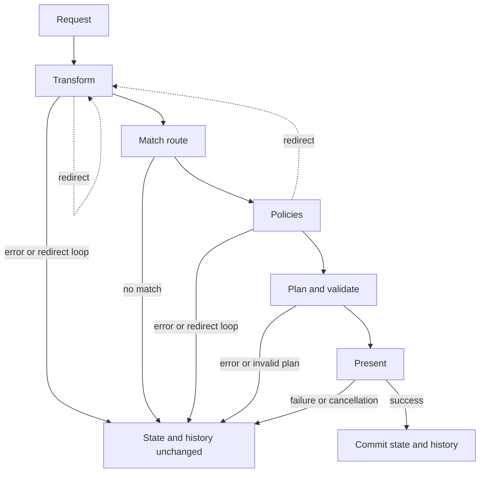

# Architecture

> **Status:** this page describes the design AppNav is being built to. The code arrives in small pull requests in a planned order, and until a part has landed, the types named here do not exist yet. Type names are the planned ones and may change before they ship. Sections will link to code as it lands.

## The central idea

AppNav treats navigation as durable logical state, not as a sequence of page operations.

A **route** is a typed value that names a destination in application terms, such as `InventoryItemRoute(itemId)`. It is not a page, a view model or a command. Routes derive from `AppRoute`, and a **route table** maps each route type to a URI template, for matching and formatting.

**Navigation state** (`NavigationState`) is an immutable tree of windows, stacks, branch hosts (such as tabs) and modals whose leaves are **route entries**: one occurrence of a route, with a stable ID. It holds no pages, controls or view models.

The **router** (`IRouterNavigator`) owns the current navigation state. Every change to it, whether from a request, a Back or the user acting on native UI, goes through the router, which commits a new state only after the presenter has shown it.

The **host** is the application code that owns the native UI: its windows, lifecycle and platform events. A **presenter** (`INavigationPresenter`) shows navigation state on the host's **navigation surface**, the part of the native UI that the presenter alone drives, made of **native artifacts** such as views. Native artifacts are disposable: they can be torn down and recreated from the current state without a new navigation or a change to history.

## The path of one navigation

1. **Request.** Every navigation is a `RouterNavigationRequest`: exactly one target, a URI or a typed route, plus how it arrived: its **source**, such as an in-app command, an app link, a push notification, a QR code or a test; its **disposition** (step 5); an optional target window; a timestamp; request metadata; and optional **provenance**, provider-specific context such as the original URI and a correlation ID. None of this is part of the destination's identity.
2. **Transform.** Request transformers can normalize or replace the target, for example rewriting an outdated URI.
3. **Match.** A URI target is matched against the route table to produce a typed route. A URI that matches no route template fails the navigation unless the application supplies a fallback route. A URI that matches a template but carries an invalid value always fails.
4. **Policies.** Request policies run against the matched route and the current state; each keeps the request or returns a different one. The built-in access gate asks an application-supplied evaluator to allow the request, redirect it, or defer it (see deferred navigation below) and redirect. A change of target restarts resolution at step 2; redirects are bounded, and a redirect loop fails the navigation.
5. **Plan.** A **planner** (`IAppNavigationPlanner`) receives the request, the typed route and the current state, and returns a `NavigationPlan` holding the complete target state. Applications can write a planner or declare **navigation models**, which the standard planner turns into plans. The stack model declares a canonical stack for each route; the branch-host model adds branches, such as tabs, that each keep an independent stack.

   The disposition tells the planner how to relate the destination to the current state:

   | Disposition | Planning |
   | --- | --- |
   | `Contextual` | Push onto a compatible current stack |
   | `ReplaceCurrent` | Replace the top entry of the current stack |
   | `Canonical` | Build the route's declared shape, whatever the current state |
   | `Auto` | The standard planner treats it as `Contextual` for in-app and test requests and `Canonical` otherwise; a hand-written planner receives `Auto` as is |

   When a `Contextual` or `ReplaceCurrent` request cannot be satisfied, including when it targets a window that is not active, the standard planner builds the canonical state instead and marks the plan as a fallback.
6. **Validate.** The router validates the plan's target state before anything is presented.
7. **Present.** The router passes the plan to the presenter's `ApplyAsync`, which changes the navigation surface to match.
8. **Commit.** Only after `ApplyAsync` succeeds does the router make the target its current state and add an entry to its **history**, a bounded record of committed operations.

A successful navigation returns a `NavigationResult` with the final route, the applied plan and the committed state. Every navigation failure throws instead: an unmatched URI, a redirect loop, an invalid plan, an exception from a transformer, policy, planner or presenter, or cancellation. A policy denies a request by redirecting it, which is a success. A navigation that fails at any step leaves state and history unchanged.

The pipeline emits structured diagnostic events, correlated by an operation ID, to observers, `ILogger` and an `ActivitySource`.

## Other operations

Back, reconciliation and refresh also go through `ApplyAsync`: Back with its plan; reconciliation with the state the host already shows, so that the presenter can confirm it matches the navigation surface and adopt it rather than navigate (the result reports `Presented` as false); refresh with the current state unchanged.

- **Back.** A **back navigator** (`IBackNavigator`) plans one logical Back from the current state. The default one lets the content of a modal handle it first, then dismisses the modal, pops a stack (the selected branch's content first), or returns a branch host to its default branch. Back policies can inspect the candidate plan and cancel it before presentation. A Back returns one of three results: `Completed`, with the committed state; `Canceled`, when a Back policy cancels it or the modal that asked for it is no longer on top; or `Unhandled`, when nothing in the state can handle it. Only `Unhandled` tells the host to apply its own root-level behavior. Failures throw, as they do for a navigation. A Back the host starts, such as a system Back gesture, is recorded with a host-Back source.
- **Reconciliation.** When the user changes the navigation surface directly, by a swipe-back gesture or a tab selection, for example, the presenter reports the committed state the change started from and the state the host now shows. The router commits it, with a host-reconciliation source, only if that starting state is still the current one; otherwise it rejects the reconciliation as stale. Waiting reconciliations are admitted before any queued navigation, Back or refresh, because the host already shows their state.
- **Refresh.** After the host recreates its native artifacts, it asks the router to reapply the current state. Refresh plans nothing and changes neither state nor history.

## Layers

The core library's layers, in the order they are built; each builds mainly on those above it. Back navigation and route-entry leases are the exception: they come after the router and extend it, and the router gains its Back operation and its lease handling when they land.

| Layer | Owns |
| --- | --- |
| Routing | Route templates, constraints and value codecs; the route table; matching and formatting; convention routes; route metadata |
| Navigation state | `NavigationState` and its nodes, structural identity and validation, `NavigationPlan`, metadata lifetimes |
| Requests, provenance and deferral | `RouterNavigationRequest`, sources, dispositions and provenance; the deferred-request store contract and an in-memory store |
| Planner contracts and policies | `IAppNavigationPlanner`, request transformers and policies, the access gate |
| Navigation models | Stack and branch-host models, route recipes, the standard planner |
| Presenter contract and topology | `INavigationPresenter`, presentation context, reconciliation, `NavigationTopology` |
| Diagnostics | Diagnostic events, data redaction, logging and activity sources |
| The router | `IRouterNavigator` and its factory: the pipeline, results, fallback routes, history, serialized operations, redirect-loop protection, reconciliation, refresh |
| Back navigation | `IBackNavigator`, the default back navigator, Back policies |
| Deferred navigation | The versioned request serializer and the replayer |
| Route-entry leases | `RouteEntryLease`, its registry, and its part in the router's commit |

**Deferred navigation** keeps a request for later replay, across sign-in or a process restart. The core defines the store contract and an in-memory store; a host supplies durable storage. The serializer writes a deliberately limited, versioned snapshot of each request: its target formatted as a canonical URI, its source, window, disposition, timestamp, the metadata it is configured to keep, and only the provider name from its provenance. Replay runs when the application asks for it, for example after sign-in: the replayer submits stored requests to the router in order and removes each one that navigates. A request that fails stays queued, and when to retry is left to the host.

A **route-entry lease** (`RouteEntryLease`) owns what one route entry borrows, such as a view model, a dependency-injection scope or a subscription, for as long as that entry is part of the state. The core retires a lease when its entry leaves: a commit drops the entry, the navigation that introduced it ends without committing, the application or a parent lease retires it, or the router shuts down. It releases the lease only once the code that opened it has closed it and no native artifact, child lease or tracked work still holds it.

## Packages

`AdamE.AppNav` is the core: every layer above, with no UI framework dependency. It targets `net11.0`, is trim- and AOT-compatible, and runs in plain unit tests without a device or UI thread.

Presenter packages sit on top. Each implements `INavigationPresenter` for one UI technology using only the core's public API; an application's routes, models and policies do not change with the presenter. The first presenters will target SwiftUI on iOS and Jetpack Compose on Android.

A presenter **must**:

- map route entries to its own native artifacts;
- return from `ApplyAsync` only once the target state is fully shown, and throw or observe cancellation otherwise, finishing its rollback before it throws;
- report the user's own changes to the navigation surface as reconciliations naming the state they started from;
- handle native events and the thread affinity of its native artifacts.

A presenter **must not**:

- change the navigation surface outside `ApplyAsync`, except as the user's changes it reports;
- treat its own view of the navigation surface as committed state, or reapply a cached target outside a refresh;
- share its navigation surface with another router.

`NavigationTopology` is for presenters with a fixed shape: one window with one root stack and at most one of its declared modals over it at a time. Such a presenter checks every plan against the declared shape, and against its own limits, before it changes anything.

## Invariants

- **Operations are serialized.** The router runs navigation, Back, reconciliation and refresh one at a time.
- **Presentation precedes commit.** A failed or cancelled operation leaves state and history unchanged.
- **State is immutable and validated.** Navigation state is made of immutable records, and the router validates its initial state when it is created and every state before it commits it, whether the state comes from a plan or a reconciliation. A reconciliation whose state fails validation throws and commits nothing; when the presenter raised it as an event, the failure is reported as a diagnostic event instead.
- **Stale reconciliations are rejected.** A reconciliation commits only against the exact state it was observed from.
- **Back does not traverse history.** History records what was committed; Back plans from the current state.
- **Diagnostics never change outcomes.** The result or exception of an operation is authoritative; diagnostic events only observe it.
